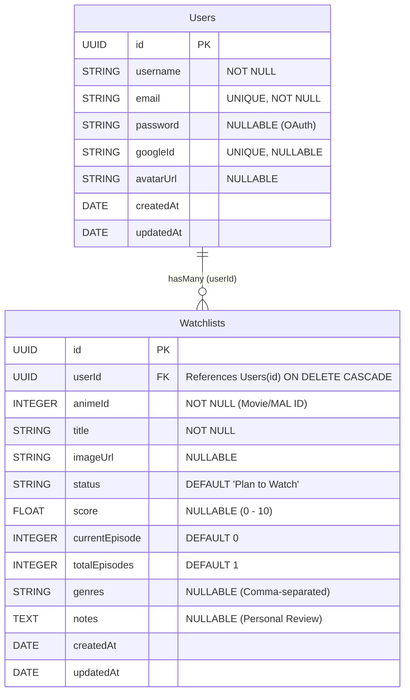

# Architecture Requirements Document (ARD)
## BLUVERIROLL — Full-Stack Technical Architecture

---

## 1. High-Level System Architecture

```mermaid
flowchart LR
    subgraph Client["Client (Vite + React + Redux Toolkit)"]
        UI["React Pages & Components"]
        Store["Redux Store (Async Thunks)"]
        UI -->|dispatch(thunk)| Store
        Store -->|useSelector(state)| UI
    end

    subgraph Server["Server (Node.js + Express 5)"]
        Router["Modular API Routes"]
        AuthMW["Auth & Ownership Middlewares"]
        Controllers["Controllers"]
        Services["3rd Party Services"]
        ORM["Sequelize ORM"]
        Router --> AuthMW --> Controllers
        Controllers --> Services
        Controllers --> ORM
    end

    subgraph External["Database & 3rd Party APIs"]
        DB[("PostgreSQL (Supabase)")]
        OpenAI["OpenAI API (gpt-4o-mini)"]
        Jikan["Jikan Movie & Anime API"]
        Google["Google OAuth 2.0"]
        Pollinations["Pollinations AI (Image Gen)"]
    end

    Store <-->|REST JSON + Bearer JWT| Router
    ORM <--> DB
    Services <--> OpenAI
    Services <--> Jikan
    Controllers <--> Google
    Services <--> Pollinations
```

---

## 2. Database Schema (ERD)



---

## 3. Backend Architecture (`server/`)

### 3.1. Directory Structure
```text
server/
├── bin/www.js                 # HTTP Server entry point
├── config/database.js         # Sequelize config (Postgres Dev/Prod, SQLite in-memory Test)
├── controllers/
│   ├── authController.js      # Register, Login, Google OAuth, GetMe
│   ├── animeController.js     # Popular, Search (with Movie/TV type filter), Detail, Genres
│   ├── watchlistController.js # Full CRUD Watchlist connected to Sequelize Watchlist model
│   ├── moodSyncController.js  # OpenAI NLU Mood analysis + Pollinations AI + Jikan query
│   └── profileController.js   # Anime/Cinema DNA analytics & Watch Journey from DB
├── helpers/
│   ├── bcrypt.js              # Password hashing & verification
│   └── jwt.js                 # JWT token signing & verification
├── middlewares/
│   ├── authMiddleware.js      # authentication & watchlistAuthorization (ownership check)
│   └── errorHandler.js        # Centralized Express error handler
├── migrations/
│   ├── 20261104000001-create-users.js
│   └── 20261104000002-create-watchlists.js
├── models/
│   ├── index.js
│   ├── user.js
│   └── watchlist.js
├── routes/
│   ├── index.js
│   ├── authRoutes.js
│   ├── animeRoutes.js
│   ├── watchlistRoutes.js
│   ├── moodSyncRoutes.js
│   └── profileRoutes.js
├── seeders/
│   └── 20261104000001-seed-users.js
├── services/
│   ├── jikanService.js
│   └── openaiService.js
└── __tests__/                 # Jest + Supertest suites (>= 90% coverage target)
```

### 3.2. REST API Endpoints Specification
| Method | Endpoint | Auth | Description |
| :--- | :--- | :--- | :--- |
| `POST` | `/api/auth/register` | Public | Register user baru |
| `POST` | `/api/auth/login` | Public | Login email & password, return `access_token` |
| `POST` | `/api/auth/google` | Public | Login/Register via Google ID Token |
| `POST` | `/api/auth/google-login` | Public | Alias Google Login untuk kompatibilitas |
| `GET` | `/api/auth/me` | Bearer JWT | Ambil profil user yang sedang login |
| `GET` | `/api/anime/popular` | Public | Ambil katalog populer (`?page=1&limit=12&type=movie`) |
| `GET` | `/api/anime/search` | Public | Cari berdasarkan `q`, `type` (`movie`/`tv`), `genres`, `order_by` |
| `GET` | `/api/anime/genres` | Public | Daftar seluruh genre |
| `GET` | `/api/anime/:id` | Public | Detail lengkap movie/anime berdasarkan ID |
| `GET` | `/api/watchlist` | Bearer JWT | Ambil seluruh item watchlist milik user |
| `POST` | `/api/watchlist` | Bearer JWT | Tambah movie/anime ke watchlist (`201 Created`) |
| `PUT` | `/api/watchlist/:id` | Bearer JWT + Owner | Update status, episode, score, atau review notes |
| `DELETE` | `/api/watchlist/:id` | Bearer JWT + Owner | Hapus item dari watchlist |
| `POST` | `/api/moodsync/recommend` | Public | Analisis mood dengan OpenAI + Pollinations AI banner + rekomendasi |
| `GET` | `/api/profile/dna` | Bearer JWT | Kalkulasi statistik Cinema/Anime DNA dari watchlist user |
| `GET` | `/api/profile/journey` | Bearer JWT | Riwayat aktivitas watchlist terbaru |

---

## 4. Frontend & Redux Architecture (`client/`)

Sesuai **Requirement #6 Hacktiv8**, seluruh *data fetching* dilakukan melalui **Redux Store** (`createAsyncThunk` / thunk actions) sebagai *Single Source of Truth*:

1. **`store/slices/authSlice.js`**:
   - Thunks: `loginUser`, `registerUser`, `googleLoginUser`, `fetchCurrentUser`
   - State: `user`, `token`, `isAuthenticated`, `loading`, `error`
2. **`store/slices/animeSlice.js`**:
   - Thunks: `fetchPopularAnime`, `searchAnimeCatalog`, `fetchAnimeDetail`, `fetchAnimeGenres`
   - State: `popularList`, `searchResults`, `currentAnime`, `genres`, `activeTypeFilter` (`all` | `movie` | `tv`), `loading`, `error`
3. **`store/slices/watchlistSlice.js`**:
   - Thunks: `fetchWatchlist`, `addWatchlistEntry`, `updateWatchlistEntry`, `deleteWatchlistEntry`
   - State: `items`, `selectedFilter`, `loading`, `error`
4. **`store/slices/moodSyncSlice.js`**:
   - Thunks: `generateMoodRecommendations`, `fetchProfileAnalytics`
   - State: `moodAnalysis`, `recommendations`, `dna`, `journey`, `loading`, `error`


---

## 5. Production Deployment Guide (Supabase + AWS EC2 + Cloudflare)

### 5.1. Supabase PostgreSQL Setup
1. Gunakan URI Connection Pooler dari Supabase (`PORT 5432` Session Pooler untuk migration, atau `PORT 6543` Transaction Pooler).
2. Di [`server/config/database.js`](./server/config/database.js), opsi `ssl: { require: true, rejectUnauthorized: false }` dan connection `pool` (`max: 5`, `idle: 10000`) sudah diaktifkan secara otomatis untuk `production`.

### 5.2. AWS EC2 + PM2 Deployment (`server/`)
```bash
# 1. Clone repository & masuk ke folder server
cd server
npm install

# 2. Jalankan migration & seeder ke Supabase
NODE_ENV=production DATABASE_URL="postgresql://..." npm run db:setup

# 3. Buat/edit ecosystem.config.js (atau gunakan template ecosystem.config.example.js)
cp ecosystem.config.example.js ecosystem.config.js
nano ecosystem.config.js

# 4. Jalankan server dengan PM2
sudo pm2 start ecosystem.config.js
sudo pm2 save
sudo pm2 startup
```

### 5.3. Cloudflare DNS & SSL Setup
1. **DNS A Record**: Arahkan `@` atau subdomain `api.domainkamu.com` ke **Public IPv4 AWS EC2** dengan status **Proxied (Orange Cloud)**.
2. **SSL/TLS Mode**:
   - Jika EC2 langsung jalan di `PORT=80` (tanpa sertifikat SSL di EC2), atur SSL/TLS Cloudflare ke **Flexible** agar `https://api.domainkamu.com` langsung aktif otomatis tanpa Mixed Content error.
   - [`server/app.js`](./server/app.js) sudah dilengkapi `app.set('trust proxy', 1)` dan CORS dinamis (`origin: allowedOrigins`, `credentials: true`) sehingga header proxy dari Cloudflare & browser tidak akan terkena blokir CORS.
